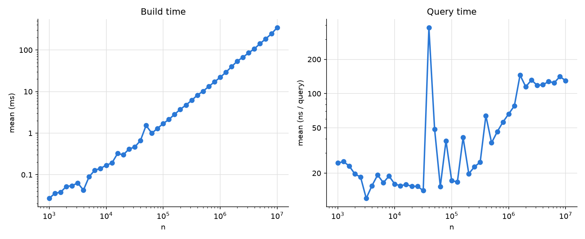
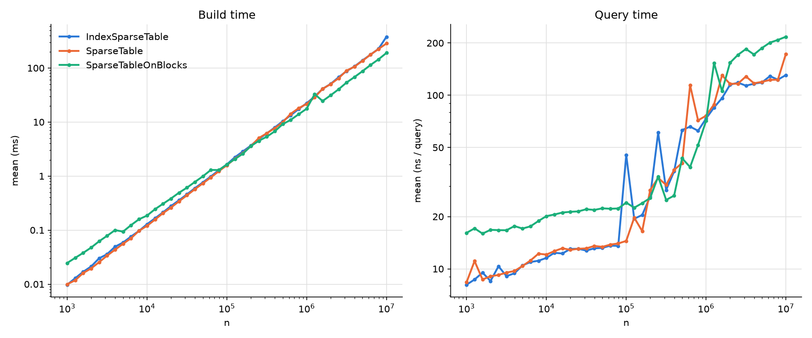

# Experiments on sparse tables

## Problem

Given an array of u64 I want to build a sparse table on it and optimize its runtime/space performance.

## Benchmarking

I first need to setup proper benchmarking. The goal is to run increasingly large benchmarks and track data structure size and query time.

For now I will simply write the main function to run the benchmarks, so I can control their execution independently of any frameworks.

### Initial results on Offset Sparse Table

The results are noisy and only exist for one version of the sparse table. Next I want to add support for comparing multiple tables.

### Allowing comparison of table versions first

The results remain somewhat noisy. Unsurprisingly the IndexSparseTable and OffsetSparseTable have very similar performance, since the latter doesn't yet use bitpacking.

## Sparse Table improvements

Note: All values for space and time complexity are upper bounds. The actual values can be slightly lower

### Standard Sparse table

We precompute $argmin_{x \in [l, r]}(A[x])$ for all segments $[l, r]$ of length $2^k$ ($k \gt 0$).
There are $log(n)$ different such lengths. Per length we store $n-length \le n$ answers.

Space usage (on top of $A$): $log(n) \cdot n$ words. This can be improved to $log^2(n) \cdot n$ bits with bitpacking.

### Storing relative positions (offsets)

Instead of storing $x$ we can store $d= x-l \lt 2^k$. These offsets can than be packed more tightly since d only needs k bits instead of the full $log(n)$.

Space usage: $\frac{log^2(n)}{2} \cdot n$

### Table over blocks

Any RMQ structure (relying on A) with space usage in $O(f(n))$ and constant queries can be constructed over blocks of A instead leading to space usage $O(f(n/a))$ and queries in $O(a)$ via a linear scan.

Space usage: $log^2(\frac{n}{a})\cdot \frac{n}{a}$

Query time: $a$

### Bitmasks (from Codeforces blogpost)

Instead of a linear scan on the blocks we can store a bitmask at each position.

TODO: Explain

Space usage:   $log(n) \cdot n$

Query time: Constant